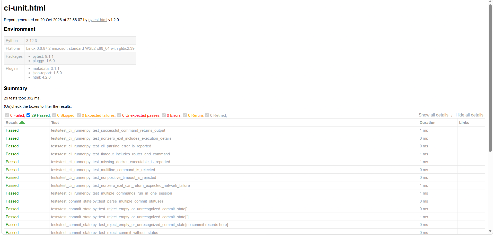

# Network Test & Validation Platform

[](https://github.com/kapiliyer10/network-test-validation-platform/actions/workflows/ci.yml)

A Python-based network testing and validation framework for a containerized Nokia SR Linux environment.

The platform validates connectivity, protocol behavior, routing, failure recovery, application traffic, and network performance using pytest, pyATS, Docker, and Containerlab.

**`network-automation-platform` manages the network. `network-test-validation-platform` validates its behavior.**

---

## 1. Project Overview

The Network Test & Validation Platform automates network quality assurance against a live network environment.

Its workflow is:

**Define expected behavior → Execute tests → Observe network behavior → Compare results → Collect diagnostic evidence → Generate reports**

This repository (`network-test-validation-platform`) is maintained separately from `network-automation-platform`.

| Repository | Responsibility |
|---|---|
| `network-automation-platform` — Network Automation | Device state discovery, desired-state configuration, drift detection, and configuration management |
| `network-test-validation-platform` — Network Validation | Connectivity, protocol, traffic, performance, failure, recovery, and regression testing |

`network-test-validation-platform` reuses `network-automation-platform`'s expanded Containerlab topology instead of duplicating its network configuration and management implementation.

## 2. Key Features

### Router and protocol validation

- ICMP connectivity and negative-connectivity testing.
- Ethernet interface operational-state validation.
- OSPF neighbor and route validation.
- LLDP neighbor validation.
- Controlled link failure, failover, and recovery testing.
- pytest and native pyATS AEtest execution.
- Reusable testbed and device abstractions.
- Docker-based SR Linux CLI execution.

### Application and traffic validation

- TCP and UDP application request/response testing.
- TCP iperf3 tests with configured target bitrates of 10, 25, and 50 Mbps, with receiver-throughput and retransmission thresholds.
- UDP iperf3 tests with configured target bitrates and receiver-throughput, packet-loss, and jitter thresholds.
- Controlled packet-loss and delay experiments.
- ICMP round-trip latency and packet-loss measurements.
- Automated packet capture using tcpdump.
- PCAP evidence for Wireshark troubleshooting.

### Reporting and CI/CD

- JUnit XML test reports.
- Self-contained HTML reports.
- Raw pytest JSON reports.
- Quality-metrics JSON summaries.
- GitHub Actions CI/CD.
- Jenkins Declarative Pipeline.
- Automated test artifact collection.

## 3. Architecture

`network-test-validation-platform` combines two validation paths:

1. Router and protocol testing through pytest, pyATS AEtest, a shared testbed abstraction, and the Docker-based CLI runner.
2. Traffic and performance testing through dedicated Linux endpoints H1 and H2 connected through the SR Linux network.

See **[System Architecture](docs/architecture.md)** for the architecture diagram and component responsibilities.

The detailed test execution instructions are available in **[Test Execution and Reporting](docs/testing-and-reporting.md)**.

## 4. Network Topology

`network-test-validation-platform` uses `network-automation-platform`'s expanded `srl-expanded` topology.

It contains three Nokia SR Linux routers and two Linux traffic endpoints.

```text
             H1
              |
              R1
             /  \
            /    \
           R3----R2
                  |
                  H2
```

The routed traffic path between endpoints is:

**H1 → R1 → R2 → H2**

The R3 connection provides the alternate router path used for failover validation.

Endpoint addressing:

| Endpoint | Connected router | IP address |
|---|---|---|
| H1 | R1 | 10.0.14.2/30 |
| H2 | R2 | 10.0.24.2/30 |

The expanded lab uses the container prefix:

`clab-srl-expanded-`

`network-automation-platform` owns the topology definition and startup/shutdown scripts. `network-test-validation-platform` consumes the running lab for validation.

See **[System Architecture and Automation Repository Relationship](docs/architecture.md)** for more detail.

## 5. Technology Stack

| Category | Technologies |
|---|---|
| Programming | Python 3.12 |
| Test automation | pytest, pyATS AEtest |
| Configuration | YAML, PyYAML |
| Network lab | Containerlab, Docker |
| Network operating system | Nokia SR Linux |
| Traffic generation | iperf3 |
| Troubleshooting | tcpdump, Wireshark, PCAP |
| Reporting | JUnit XML, pytest-html, JSON, quality metrics |
| CI/CD | GitHub Actions, Jenkins |
| Operating environment | Linux |

Genie parsers are not used for SR Linux in this implementation. Structured router state is validated using native JSON output and Python parsing where applicable.

## 6. Prerequisites

Before running `network-test-validation-platform`, install:

- Python 3.12.
- Docker Engine.
- Containerlab.
- Git.

Docker Engine must be running and accessible to your user.

The setup script checks these prerequisites but does not install system-level Docker or Containerlab packages.

## 7. Set Up the Environment

Clone `network-test-validation-platform`:

```bash
git clone https://github.com/kapiliyer10/network-test-validation-platform.git
cd network-test-validation-platform
```

Run the one-command environment setup:

```bash
./scripts/setup_environment.sh
```

The script:

1. Checks the required tools and environment.
2. Clones `network-automation-platform` if the expected checkout does not exist.
3. Creates the `network-test-validation-platform` virtual environment.
4. Installs the pinned Python dependencies.
5. Checks dependency consistency.
6. Builds the Linux endpoint Docker image.
7. Deploys `network-automation-platform`'s expanded topology when necessary.
8. Waits for endpoint services.
9. Checks router readiness.

An existing `network-automation-platform` checkout is reused without pulling or modifying its Git history or working-tree changes.

By default, `network-automation-platform` is expected at:

`~/network-automation-platform`

To select a different `network-automation-platform` checkout:

```bash
PROJECT1_DIR="$HOME/projects/network-automation-platform" \
  ./scripts/setup_environment.sh
```

Activate the `network-test-validation-platform` virtual environment:

```bash
source .venv/bin/activate
```

Verify dependencies:

```bash
python -m pip check
```

Check router readiness:

```bash
python -m scripts.check_lab_readiness
```

## 8. Running Tests

### Run unit tests

```bash
pytest -q -m unit
```

### Run expanded-lab integration tests

```bash
pytest -q -m expanded_lab
```

### Run the complete pytest regression suite

```bash
pytest -v
```

A recorded local full-suite run completed with:

```text
43 passed in 103.07s
```

The separate pyATS AEtest suites require their own invocation and are not automatically included in `pytest -v`.

See **[Test Execution and Reporting](docs/testing-and-reporting.md)** for individual test commands, performance experiments, controlled impairments, packet capture, and pyATS instructions.

## 9. Reporting and Test Evidence



*Example of the HTML test report generated by the project.*

The reporting utility is:

`scripts/run_test_reports.py`

It executes a pytest selection and generates four report formats:

| Format | Purpose |
|---|---|
| JUnit XML | Structured test results for CI systems |
| HTML | Human-readable test report |
| JSON | Machine-readable pytest results |
| Quality metrics JSON | Aggregated test counts, pass rate, timings, and failure details |

Reports are stored under:

`artifacts/reports/`

Packet captures are stored separately under:

`artifacts/pcap/`

Generated reports and PCAP files are excluded from Git because they are test artifacts.

To generate reports for unit and expanded-lab tests:

```bash
python -m scripts.run_test_reports \
  --markers "expanded_lab or unit" \
  --name local-regression
```

## 10. CI/CD

`network-test-validation-platform` supports two CI execution environments.

### GitHub Actions

Workflow:

`.github/workflows/ci.yml`

The workflow runs on:

- Pushes to `master` or `main`.
- Pull requests targeting `master` or `main`.
- Manual workflow dispatch.

It contains two jobs:

1. Unit tests and reports.
2. Expanded-lab integration tests and reports.

The expanded-lab job checks out `network-automation-platform`, installs Containerlab, builds the endpoint image, deploys the expanded topology, waits for endpoint services, runs tests, uploads reports, and destroys the lab.

### Jenkins

The repository also includes a Declarative Pipeline:

`Jenkinsfile`

The Jenkins job retrieves `network-test-validation-platform` from GitHub and executes the same main validation workflow.

Pipeline stages:

1. Validate Jenkins Agent.
2. Set Up Environment.
3. Unit Tests and Reports.
4. Expanded-Lab Integration Tests and Reports.

Jenkins publishes JUnit XML results and archives HTML, JSON, quality-metrics, and failure-related PCAP artifacts.

The local Jenkins installation uses the Built-In Node with the `network-lab` label.

**Recorded local Jenkins verification:** Build #7 completed successfully, the Jenkins dashboard reported no test failures, and eight reporting artifacts were archived. It was manually triggered using **Build Now**; automatic GitHub webhook triggering is not configured.

See the milestone document for the recorded verification history.

## 11. Repository Structure

```text
network-test-validation-platform/
│
├── .github/
│   └── workflows/
│       └── ci.yml
│
├── artifacts/
│   ├── pcap/
│   └── reports/
│
├── configs/
│   ├── lab.yaml
│   ├── lab-expanded.yaml
│   └── pyats-testbed.yaml
│
├── docs/
│   ├── architecture.md
│   ├── milestones.md
│   ├── testing-and-reporting.md
│   └── images/
│
├── scripts/
│   ├── check_lab_readiness.py
│   ├── run_test_reports.py
│   ├── setup_environment.sh
│   └── summarize_quality_metrics.py
│
├── src/
│   ├── packet_capture.py
│   ├── quality_metrics.py
│   └── ...
│
├── tests/
│   ├── aetest/
│   ├── integration/
│   └── ...
│
├── Jenkinsfile
├── pytest.ini
├── requirements.txt
└── README.md
```

## 12. Documentation

| Document | Description |
|---|---|
| [System Architecture](docs/architecture.md) | Components, test execution paths, topology, and data flow |
| [Test Execution and Reporting](docs/testing-and-reporting.md) | pytest, pyATS, performance, packet capture, and reporting instructions |
| [Implementation Milestones](docs/milestones.md) | Full development history, implementation details, and verification records |

## 13. Current Project Status

All nine documented project milestones are complete.

The completed platform includes router and protocol validation, traffic and performance testing, failure and recovery testing, packet capture, reporting, and CI/CD integration.

The full milestone history and its verification records are maintained in **[Implementation Milestones](docs/milestones.md)**.

## 14. Development Principles

- Keep `network-automation-platform` and `network-test-validation-platform` separate.
- Reuse the existing network rather than rebuilding its configuration-management implementation.
- Validate observable network behavior.
- Distinguish diagnostic responses from successful application-level communication.
- Use unit tests for isolated logic and live integration tests for real network behavior.
- Collect diagnostic evidence and report failures clearly.
- Introduce additional abstractions only when they provide demonstrated value.
