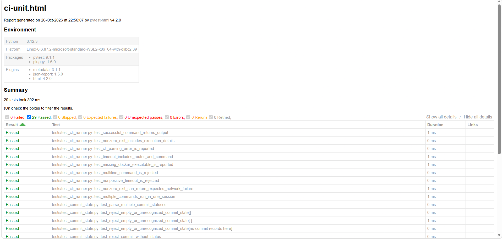

# Network Test & Validation Platform

A Python-based network test automation framework that validates the **behavior, reliability, and performance** of a live, containerized Nokia SR Linux network.

Built with **pytest, pyATS, Docker, and Containerlab**, the platform checks router and protocol state, application connectivity, traffic performance, controlled network impairments, and recovery after failures. It also collects packet captures and produces test evidence for local use and CI pipelines.

**Project boundary:** the companion [Network Automation & Programmability Platform](https://github.com/kapiliyer10/network-automation-platform) manages the network. This repository independently validates its observable behavior.

---

## Project highlights

| Area | Demonstrated capability |
|---|---|
| Router and protocol testing | Connectivity, interface state, OSPF neighbors and routes, LLDP, negative tests |
| Application testing | TCP and UDP request/response validation between Linux endpoints |
| Performance testing | TCP/UDP throughput, retransmissions, packet loss, jitter, and ICMP RTT |
| Fault testing | Controlled packet loss and delay, link failure, OSPF failover, and recovery |
| Troubleshooting | Filtered tcpdump captures, PCAP validation, and Wireshark analysis |
| Test evidence | JUnit XML, HTML, raw JSON, and quality-metrics JSON |
| Automation | pytest, native pyATS AEtest, GitHub Actions, and Jenkins |

### Recorded validation results

These are representative results recorded during development in the configured containerized lab. They are not production performance guarantees.

| Scenario | Recorded observation |
|---|---|
| TCP throughput | 10, 25, and 50 Mbps profiles passed; the 50 Mbps profile measured approximately 49.90–50.01 Mbps |
| UDP throughput | Approximately 10 Mbps receiver throughput with zero packet loss in recorded normal-profile runs |
| Injected UDP packet loss | A configured 1% impairment produced 1.031% measured receiver loss (89 of 8,634 packets) |
| Normal ICMP latency | One verified baseline measured 1.001 ms average RTT with 0% packet loss |
| Injected ICMP delay | A configured 20 ms one-way delay produced a recorded 21.032 ms average RTT |
| Regression suite | A recorded local full pytest run completed with **43 passed in 103.07 seconds** |

The 43-test pytest result does **not** include the separate pyATS AEtest scripts. Those suites have their own execution commands.

---

## Architecture

The component block diagram, network topology, and validation paths are documented in [System Architecture](docs/architecture.md).

---

## What is validated

**Router and protocol behavior**
- Router reachability and negative connectivity.
- Ethernet interface operational state.
- OSPF neighbor state and learned routes.
- LLDP neighbor relationships.
- Controlled link failure, alternate-path selection, and route restoration.

**Endpoint and traffic behavior**
- TCP and UDP application request/response exchanges.
- TCP throughput profiles at 10, 25, and 50 Mbps, including receiver throughput and retransmission thresholds.
- UDP throughput, packet-loss, and jitter thresholds using iperf3 JSON results.
- ICMP round-trip latency and packet loss.
- Controlled delay, packet-loss, and jitter experiments using Linux traffic control.

**Evidence and reporting**
- Filtered tcpdump captures saved as PCAP files.
- Packet decoding checks before a capture is accepted.
- Wireshark inspection of representative TCP, UDP, and ICMP traffic.
- JUnit XML, self-contained HTML, raw pytest JSON, and aggregated quality metrics.

---

## Technology stack

| Category | Technologies |
|---|---|
| Language | Python 3.12 |
| Test automation | pytest, pyATS AEtest |
| Lab and containers | Containerlab, Docker |
| Network OS | Nokia SR Linux |
| Test configuration | YAML, PyYAML |
| Traffic and measurement | iperf3, ping, Linux tc/netem |
| Packet analysis | tcpdump, Wireshark, PCAP |
| Reporting | JUnit XML, pytest-html, JSON, custom quality metrics |
| CI/CD | GitHub Actions, Jenkins |

---

## Run the tests

### Prerequisites

- Linux environment.
- Python 3.12.
- Docker Engine running and accessible to your user.
- Containerlab.
- Git.

### Prepare the environment

Clone the repository and run the setup script:

~~~bash
git clone https://github.com/kapiliyer10/network-test-validation-platform.git
cd network-test-validation-platform
./scripts/setup_environment.sh
source .venv/bin/activate
~~~

The setup script checks prerequisites, prepares the companion Network Automation repository if needed, creates the Python virtual environment, installs pinned dependencies, builds the Linux endpoint image, deploys the expanded lab when necessary, and checks endpoint/router readiness.

By default, the companion repository is expected at **$HOME/network-automation-platform**. The location can be overridden with **PROJECT1_DIR**; see the [test execution guide](docs/testing-and-reporting.md) for details.

### Execute pytest

~~~bash
# Isolated unit tests
pytest -q -m unit

# Live expanded-lab integration tests
pytest -q -m expanded_lab

# Complete pytest regression suite
pytest -v
~~~

The expanded lab must be running before expanded-lab tests or the complete regression suite are executed. Pytest markers select tests; they do not deploy or destroy the lab.

The recorded full-suite result above is from a local run. The separate pyATS AEtest suites are not included in these pytest commands.

For individual test modules, pyATS commands, traffic experiments, report generation, and cleanup instructions, see [Test Execution and Reporting](docs/testing-and-reporting.md).

---

## Test reports and packet evidence

The reporting utility is **scripts/run_test_reports.py**. It executes a selected pytest group once and creates:

| Artifact | Use |
|---|---|
| JUnit XML | Structured results for CI systems |
| HTML report | Human-readable execution summary and test details |
| Raw JSON | Machine-readable pytest results |
| Quality-metrics JSON | Counts, pass rate, timings, categories, and failure details |

Generate a report for unit and expanded-lab tests:

~~~bash
python -m scripts.run_test_reports \
  --markers "expanded_lab or unit" \
  --name local-regression
~~~

Reports are written to **artifacts/reports/**. Packet captures are stored separately under **artifacts/pcap/**. Both directories contain generated artifacts and are excluded from Git.

*Example of the HTML report generated by the platform.*

---

## CI/CD

**GitHub Actions** is configured to run on pushes and pull requests targeting **master** or **main**, and on manual dispatch. Its workflow has separate unit-test and expanded-lab integration jobs. The integration job checks out the companion repository, builds the endpoint image, deploys the lab, waits for endpoint services, runs tests, uploads reports (and PCAPs on failure), and attempts lab cleanup.

**Jenkins** is provided as an additional Declarative Pipeline in **Jenkinsfile**. It validates the Linux agent, prepares the environment, runs unit and expanded-lab tests, publishes JUnit results, and archives reports. The documented local Jenkins verification was Build #7, manually started using **Build Now**. GitHub webhook triggering is not configured.

See [Implementation Milestones](docs/milestones.md) for the recorded verification history and [Test Execution and Reporting](docs/testing-and-reporting.md) for environment-specific execution details.

---

## Repository structure

~~~text
network-test-validation-platform/
├── .github/workflows/ci.yml       # GitHub Actions workflow
├── configs/                        # Lab, test cases, and pyATS testbed
├── docs/
│   ├── architecture.md             # Architecture and execution paths
│   ├── testing-and-reporting.md    # Setup, test, and report instructions
│   ├── milestones.md               # Delivery summary
│   └── development-history.md      # Detailed implementation record
├── scripts/                        # Setup, readiness, and reporting utilities
├── src/                             # CLI, testbed, capture, and metrics helpers
├── tests/
│   ├── aetest/                      # Native pyATS AEtest suites
│   ├── integration/                 # Live network and traffic tests
│   └── test_*.py                    # Unit tests
├── Jenkinsfile
├── pytest.ini
├── requirements.txt
└── README.md
~~~

## Technical documentation

- [System Architecture](docs/architecture.md) — components, network topology, execution paths, and project boundaries.
- [Test Execution and Reporting](docs/testing-and-reporting.md) — environment setup, pytest, pyATS, traffic experiments, packet capture, reporting, and cleanup.
- [Implementation Milestones](docs/milestones.md) — concise summary of delivered milestones.
- [Development History](docs/development-history.md) — detailed implementation notes, troubleshooting decisions, and historical verification records.

## Scope and implementation notes

- The pytest regression suite and pyATS AEtest scripts are separate execution paths.
- Genie parsers and native Unicon connection plugins are not used for Nokia SR Linux in this implementation. Router state is validated using native JSON output and Python parsing, or parsing tailored to the observed SR Linux CLI output.
- Throughput, latency, loss, and jitter values are measured in a containerized lab. They are validation observations under the configured test conditions, not production SLAs or maximum-capacity claims.
- Controlled impairment tests modify the H1 endpoint's traffic handling temporarily. Run them only in the isolated expanded lab, never on a production network.
