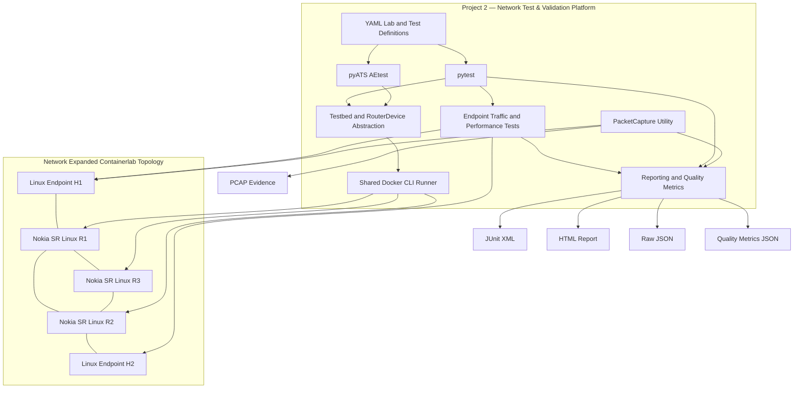

# Network-test-validation-platform — System Architecture

## 1. Overview

The Network Test & Validation Platform validates observable network behavior
using a live Nokia SR Linux environment.

The platform has two main validation paths:

1. Router and protocol validation.
2. Endpoint traffic and performance validation.

network-automation-platform owns the network automation implementation and Containerlab
topology definitions. network-test-validation-platform consumes the expanded topology as its
validation environment.

## 2. Architecture Diagram



## 3. Router and Protocol Validation

Router validation uses YAML-based test definitions and a native pyATS
testbed configuration.

The execution path is:

```text
YAML Test Definitions / pyATS Testbed
                 |
                 v
          pytest or pyATS AEtest
                 |
                 v
       Testbed and Device Abstraction
                 |
                 v
          Docker CLI Connection
                 |
                 v
           Nokia SR Linux CLI
                 |
                 v
       Parse Output and Validate State
                 |
                 v
           Test Result / Evidence
```

The Testbed and RouterDevice abstractions map logical router names to the
expanded lab's R1, R2, and R3 containers.

The custom Docker connection adapter reuses the shared CLI runner instead
of opening a persistent SSH session.

Validation areas include:

- Router connectivity.
- Interface operational state.
- OSPF neighbor state.
- Routing information.
- LLDP adjacencies.
- Negative connectivity.
- Controlled failure, failover, and recovery.

Genie parsers are not used for SR Linux in this implementation. Structured
state is validated using native JSON output and Python parsing where
applicable.

## 4. Traffic and Performance Validation

The expanded lab includes two dedicated Linux traffic endpoints.

```text
             H1: iperf3 Client
                    |
                    v
                   R1
                  /  \
                 /    \
                R3-----R2
                       |
                       v
              H2: iperf3 Server
```

H1 connects to R1 using `10.0.14.2/30`.

H2 connects to R2 using `10.0.24.2/30`.

The endpoint tests validate:

- TCP and UDP application exchanges.
- TCP throughput.
- UDP throughput.
- Packet loss.
- Jitter.
- ICMP round-trip latency.
- Controlled traffic delay and packet-loss impairments.

Traffic generation runs on Linux endpoints rather than inside the Nokia
routers.

## 5. Packet Capture and Evidence

The reusable `src/packet_capture.py` helper runs filtered tcpdump captures
on H1's `eth1` interface.

The helper:

1. Starts tcpdump inside the H1 container.
2. Waits for capture readiness.
3. Allows the test to generate traffic.
4. Stops the capture.
5. Copies the PCAP file to the Project 2 repository.
6. Verifies that packets can be decoded.

PCAP files are stored under:

`artifacts/pcap/`

These captures provide packet-level evidence alongside pytest results
and performance measurements.

The current capture helper uses `killall -INT tcpdump` inside H1.
Therefore, capture tests must run sequentially until shutdown is
implemented using process-specific identification.

## 6. Reporting Architecture

The reporting utility is:

`scripts/run_test_reports.py`

It executes a selected pytest test group and generates:

| Output | Purpose |
|---|---|
| JUnit XML | Structured test results for CI systems |
| HTML | Human-readable test report |
| Raw JSON | Machine-readable pytest results |
| Quality metrics JSON | Aggregated counts, timings, pass rate, and failure details |

The quality-metrics implementation is in:

`src/quality_metrics.py`

Reports are stored under:

`artifacts/reports/`

## 7. Project 1 and Project 2 Responsibilities

**Project 1 — Network Automation & Programmability Platform**

- Owns the Containerlab topology definitions.
- Provides the SR Linux router configurations.
- Deploys and destroys the expanded network environment.
- Implements network configuration and state-management functionality.

**Project 2 — Network Test & Validation Platform**

- Prepares the test environment.
- Executes router and endpoint validation.
- Measures traffic and performance.
- Tests failure and recovery.
- Captures packets.
- Produces test reports and quality metrics.

This separation allows Network Test & Validation Platform to validate the network without duplicating
Network Automation & Programmability Platform's configuration-management implementation.
